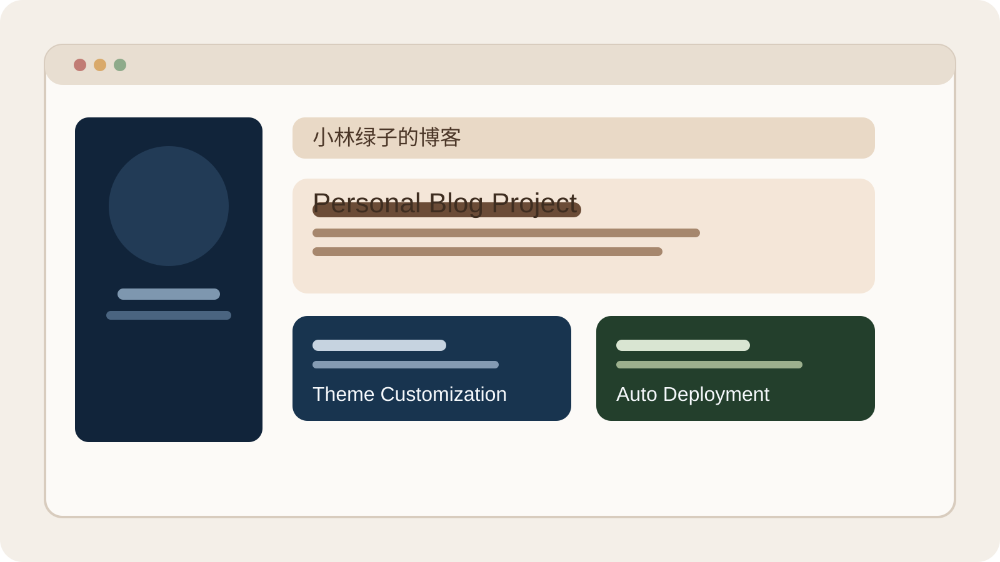
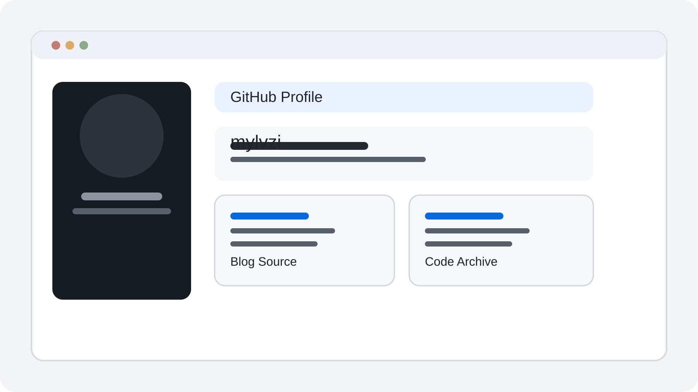

# 项目

这里记录当前我在维护的项目和公开输出。

## 博客项目

- 仓库： [mylvzi/my-blog](https://github.com/mylvzi/my-blog)
- 技术栈：GitBook、Git Sync、GitHub
- 说明：当前博客内容仓库，负责文章、知识目录与图片资源，并通过 GitBook 发布。
- 重点内容：
  - GitBook 内容结构与页面维护
  - Git Sync 自动同步与发布
  - 博客文章与长期内容沉淀

## GitHub 主页与代码归档

- 主页： [mylvzi](https://github.com/mylvzi)
- 说明：用于归档自己的代码、实验记录和持续更新的项目。
- 重点内容：
  - 博客源码与前端调整
  - 日常代码练习
  - 可持续补充的个人项目集合

## 计划补充

- QA 相关工具和脚本
- 自动化测试与效率工具
- 更完整的项目截图与使用说明
